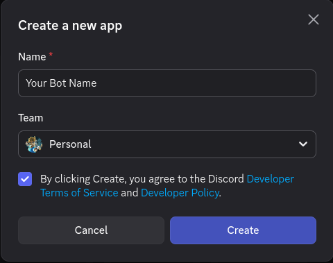
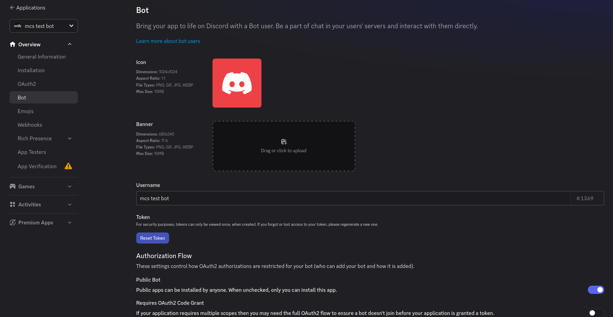
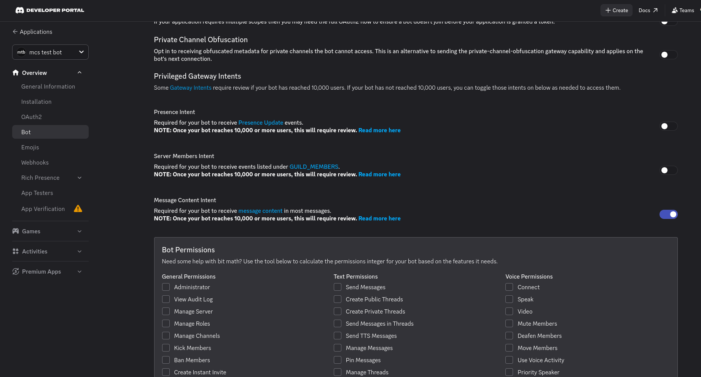
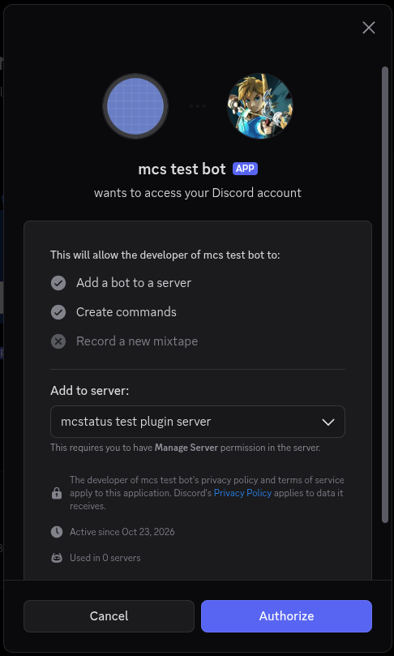
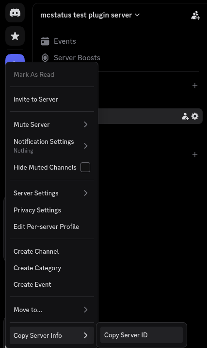
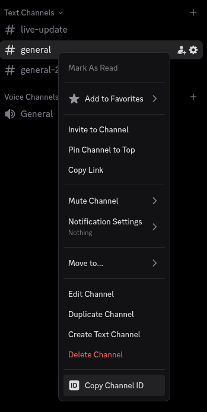

# Setting up MCStatus Self-Hosted

This guide takes you from nothing to a status panel in your Discord server in about 10 minutes.
You'll create your own Discord bot, invite it, put the jar on your server, and fill in the config.

## 1. Create your bot

1. Go to the [Discord Developer Portal](https://discord.com/developers/applications) and click **New Application** (or **+ Create** at the top).
2. In **Create a new app**, give it a name (this is the bot's name in your server), tick the terms box, and click **Create**.



3. Open the **Bot** page from the left sidebar and click **Reset Token**, then **Copy**. This is your `bot-token`.
   Keep it secret: anyone with the token can control your bot.



4. **Only if you want a text command like `!status`:** on the same Bot page, scroll down to
   **Privileged Gateway Intents** and turn on **Message Content Intent**, then **Save Changes**.



## 2. Invite the bot to your server

Open this link in your browser, replacing `CLIENT_ID` with your **Application ID** (on the **General Information** page):

```
https://discord.com/oauth2/authorize?client_id=CLIENT_ID&scope=bot+applications.commands&permissions=117760
```

Pick your server under **Add to server** and click through to **Authorize**. The link asks for exactly the permissions the bot needs:
View Channels, Send Messages, Embed Links, Attach Files (for your server icon) and Read Message History.



## 3. Copy your server and channel IDs

1. In Discord, open **User Settings → Advanced** and turn on **Developer Mode**.

2. Right-click your server's icon and choose **Copy Server Info → Copy Server ID**. This is your `discord-server-id`.



3. **Optional, for the live update message:** right-click the channel where the bot should keep its status message
   and choose **Copy Channel ID**. This is your `live-update-channel-id`. A channel only the bot can post in works best.



## 4. Install the jar

Download `MCStatus-Selfhosted-<version>.jar` from the [releases page](https://github.com/MCStatus/MCStatus-Mods-Plugins/releases).
The same jar works everywhere:

| Your server | Put the jar in |
|---|---|
| Paper, Spigot, Velocity, BungeeCord | `plugins/` |
| Fabric, Forge, NeoForge | `mods/` |

Start the server once. It creates the config file and logs a reminder to set your bot token:

- Paper/Spigot/BungeeCord: `plugins/MCStatus/config.yml`
- Velocity: `plugins/mcstatus/config.yml`
- Fabric/Forge/NeoForge: `config/mcstatus/config.yml`

## 5. Fill in the config

Open `config.yml` and fill in what you copied:

```yaml
bot-token: "your token"
discord-server-id: "123456789012345678"
prefix: "!"                                # optional, needs the Message Content Intent
live-update-channel-id: "123456789012345678"  # optional
```

Then set your server's name and footer under `servers:`, and restart the server. Every option is explained in the
comments in the file.

After the restart, the console should show `Logged in to Discord as <your bot>`.

## 6. Using it

### Live update message

The bot posts a status panel in your live update channel and keeps it updated. It shows the server's MOTD, player
count, version, online players and server icon.

When the server stops, the panel switches to offline.

### /status

Anyone can run `/status` to get the panel in any channel.

### Text command (optional)

With a prefix set, `!status` works too.

## 7. Several servers or a proxy

You can list up to 5 servers under `servers:`. On a proxy (Velocity or BungeeCord), list your backend servers, for
example `address: "127.0.0.1:25566"`. Then `/status` asks which server to show, and the live update message shows
all of them.

## 8. Customizing

The `panel:` and `messages:` sections of `config.yml` change every label and color, hide any field, and rename
the command. For example, a Spanish panel with a blue color, no version field and no player cap:

```yaml
panel:
  online-color: "#1E90FF"
  status-label: "Estado"
  online-text: "En línea"
  offline-text: "Desconectado"
  player-count-label: "Jugadores"
  show-max-players: false
  show-version: false
messages:
  command-name: "estado"
  command-description: "Ver el estado del servidor."
```

## Troubleshooting

| What you see | What to do |
|---|---|
| Console: `The bot token is invalid` | Reset the token on the Bot page and paste the new one into `bot-token`. |
| Console: `The Message Content intent is not enabled` | Turn on **Message Content Intent** (step 1.4), or set `prefix: ""`. |
| `/status` doesn't show up | Check `discord-server-id`, and that the invite link included `applications.commands`. Restarting Discord can help. |
| Console: `Live update failed: ... Missing Permissions` | Give the bot View Channels, Send Messages, Embed Links, Attach Files and Read Message History in that channel. |
| Nothing at all in the console | Check the jar is in the right folder (step 4) and the server is 1.16 or newer. |
